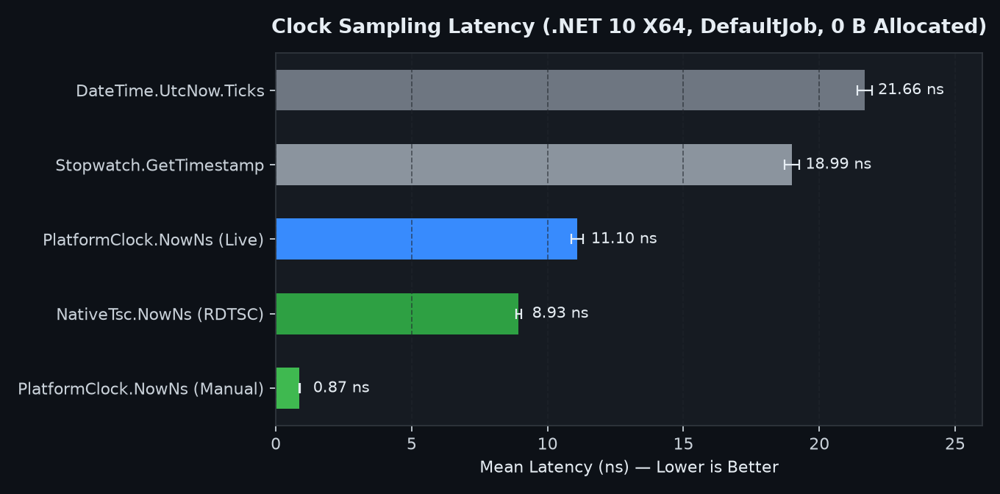
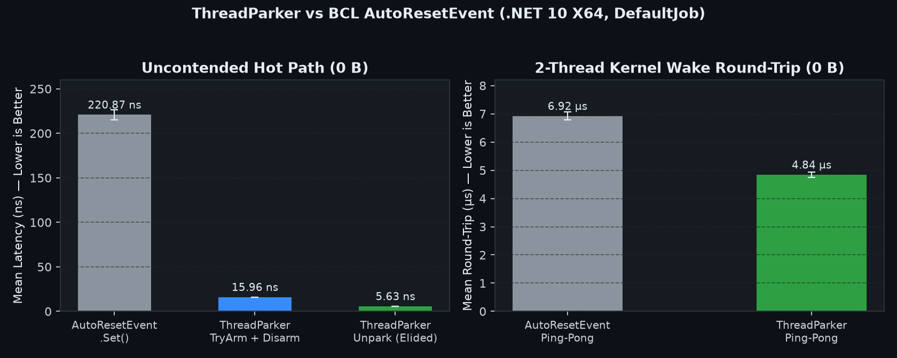

# ZeroAlloc.Platform

[](https://github.com/Markism-JA/ZeroAlloc.Platform/actions/workflows/ci.yml)
[](https://www.nuget.org/packages/ZeroAlloc.Platform)
[](./LICENSE)

Zero-allocation operating system primitives for .NET 10 and `netstandard2.1` (64-bit AnyCPU).

Compiled as `AnyCPU` and tested in CI across 64-bit `x64` and `ARM64` (`linux-x64`, `linux-arm64`, `win-x64`, `osx-arm64`). Built on top of [`ZeroAlloc.Memory`](https://www.nuget.org/packages/ZeroAlloc.Memory), it provides RDTSC Seqlock clocks, atomic two-phase thread parkers, CPU core affinity pinning, OS virtual and shared memory maps, structured cross-process IPC layouts, and lock-free `stderr` diagnostics.

---

## Origin & Intent

`ZeroAlloc.Platform` was built alongside `ZeroAlloc.Memory` as the OS abstraction layer for a high-tickrate distributed simulation engine (*Echoes of Bathala*) where:

- Polling `DateTime.UtcNow` or `Stopwatch` inside tight simulation loops added unnecessary kernel/vDSO overhead, and deterministic replay tests needed a zero-cost way to swap between live hardware time and manual clocks.
- Worker threads waking on ring-buffer activity needed to elide kernel wake syscalls (`sem_post` / `SetEvent`) when the consumer was already awake.
- Multi-process IPC required page-aligned shared memory segments with an atomic superblock header that could be discovered and attached to across Linux, Windows, and macOS (including Apple Silicon 16 KB pages).
- One unified package had to run on .NET 10 servers and `netstandard2.1` Unity clients without duplicating P/Invoke layers.

---

## Installation

```bash
dotnet add package ZeroAlloc.Platform
```

---

## Platform Support Matrix

`ZeroAlloc.Platform` uses `[LibraryImport]` source-generated P/Invoke on .NET 10 and `[DllImport]` on `netstandard2.1`. Where an operating system physically prohibits a capability, the API throws `PlatformNotSupportedException` rather than silently degrading.

| Subsystem | Linux (`x64` / `arm64`) | Windows (`x64` / `arm64`) | macOS (`arm64` / `x64`) | Notes |
| :--- | :---: | :---: | :---: | :--- |
| `NativeTsc` & `PlatformClock` | Full | Full | Full | Hardware `RDTSC` + lock-free Seqlock on `x64`; UTC-anchored `Stopwatch` (`CNTVCT_EL0` / `mach_absolute_time`) on `ARM64` and W^X-restricted runtimes. |
| `ThreadParker` | Native `sem_t` | Native Win32 Event | Managed `AutoResetEvent` | Atomic two-phase `TryArm` / `Disarm` / `Park` / `Unpark` with syscall elision while running. |
| `NativeMemoryMap` | Full (`mmap` / `shm_open`) | Full (`CreateFileMappingW`) | Full (`mmap` + `/tmp/zeroalloc_shm`) | Anonymous, named IPC shared memory, and persistent file-backed mappings. |
| `SharedMemorySession` & `Plan` | Full | Full | Full (16 KB page-aware) | Page 0 superblock + page-aligned typed regions (`AsSpan<T>`, `AsRef<T>`, `Read<T>`, `Write<T>`). |
| `SharedMemoryScanner` | Full (`/dev/shm`) | Full (`\BaseNamedObjects`) | Full (`/tmp/zeroalloc_shm`) | Zero-allocation discovery of active `Ready` superblocks. |
| `NativeDiagnostics` | Native `write(2)` | Native `WriteFile` | Native `write(2)` | Direct `stderr` sink bypassing managed `Console` locks. |
| `HighResolutionTimerScope` | No-op | `timeBeginPeriod` | No-op | Idempotent RAII scope for Windows timer resolution. |
| `CrossProcessThreadParker` | Full (`sem_open` + `sem_timedwait`) | Full (Named Event) | `PlatformNotSupportedException` | Darwin libc omits `sem_timedwait` (matches .NET BCL named `EventWaitHandle`). |
| `ThreadAffinityUtility` | Full (`pthread_setaffinity_np`) | Full (`SetThreadAffinityMask`) | `PlatformNotSupportedException` | XNU kernel on Apple Silicon forbids hard CPU core pinning. |

---

## When to Use (and When Not to Use)

| Use `ZeroAlloc.Platform` when… | Do not use when… |
| :--- | :--- |
| Standard `AutoResetEvent`, `ManualResetEventSlim`, or `DateTime.UtcNow` show up as measurable overhead in hot worker loops. | Standard .NET BCL primitives already fit your latency budget. |
| You need structured, page-aligned cross-process shared memory with atomic readiness handshakes and discovery across Linux, Windows, and macOS. | You only need basic file I/O or managed `MemoryMappedFile` wrappers. |
| You need deterministic manual-time injection (`PlatformClockBlock`) on the same call site as live hardware timestamps. | You need wall-clock timezone conversions or calendar arithmetic. |

---

## Safety Contract & Known Limitations

1. 64-bit process required: built as `AnyCPU` for `x64` and `ARM64`; 32-bit processes (`x86` / `arm32`) are unsupported.
2. Manual lifetime (`IDisposable`): `ThreadParker`, `CrossProcessThreadParker`, `NativeMemoryMap`, `SharedMemorySession`, and `HighResolutionTimerScope` own OS handles or native allocations. Failing to dispose them leaks kernel resources or unmanaged memory.
3. Unmanaged pointers and spans: pointers and `Span<T>` views returned by `NativeMemoryMap` and `SharedMemoryRegion` become invalid immediately when the owning map or session is disposed.
4. `ThreadParker` two-phase contract: `TryArm()` must be called before checking work queues and before `Park()`. Calling `Park()` without `TryArm()` can miss a concurrent `Unpark()`.
5. macOS shared-memory namespace: Darwin enforces a 31-character limit on `shm_open` names and provides no `/dev/shm` directory to enumerate, so macOS maps named segments into `/tmp/zeroalloc_shm/` with `0600` permissions.

---

## Quick Start

```csharp
using Platform.Time;
using Platform.Threading;

// 1. Nanosecond UTC timestamp via RDTSC Seqlock (or Stopwatch fallback on ARM64)
long startNs = PlatformClock.NowNs();

// 2. Two-phase thread parker: producer elides OS wake syscalls while consumer is running
using var parker = new ThreadParker();
var producerHandle = parker.NativeHandle;

if (parker.TryArm())
{
    // Re-check your lock-free queue here; if work arrived, call parker.Disarm()
    parker.Park(timeoutMs: 1);
}

// From a producer thread (blittable struct, 0 B allocation):
producerHandle.Unpark();
```

For multi-region cross-process layouts and clock calibration details, see:
- [Shared Memory & IPC Guide](./docs/shared-memory.md)
- [Time, Clocks & Windows Timers Guide](./docs/time-and-timers.md)

---

## Benchmarks (.NET 10 X64, 0 B Managed Allocation)





- `NativeTsc.NowNs`: `8.93 ns` vs `Stopwatch.GetTimestamp` (`18.99 ns`, 2.1× faster) and `DateTime.UtcNow` (`21.66 ns`, 2.4× faster), `0 B` allocated.
- `PlatformClock.NowNs`: `11.10 ns` live, `0.87 ns` manual, `0 B` allocated.
- `ThreadParker.Unpark` (running fast-path): `5.63 ns` vs `AutoResetEvent.Set` (`220.87 ns`, 39× faster), `0 B` allocated.
- `ThreadParker` 2-thread ping-pong round-trip: `4.84 µs` vs `AutoResetEvent` (`6.92 µs`, 1.43× faster), `0 B` allocated.
- `NativeMemoryMap` sequential 64 KB sum: `4.08 µs` vs managed `long[]` (`4.01 µs`, parity with zero GC tracking); `SharedMemoryRegion` cached `Read<long>` at `0.87 ns` and `AsRef<long>` at `0.98 ns`.

Full BenchmarkDotNet tables, methodology, and analysis: [docs/benchmarks/README.md](./docs/benchmarks/README.md)

---

## Building, Testing & Benchmarking

```bash
# Build solution in Release (0 warnings, CS1591 enforced)
dotnet build ZeroAlloc.Platform.slnx --no-incremental -c Release

# Run full test suite (104 tests) in Release and Debug
dotnet test ZeroAlloc.Platform.slnx -c Release --no-build
dotnet test ZeroAlloc.Platform.slnx -c Debug

# Verify netstandard2.1 target
dotnet build src/Platform/Platform.csproj -c Release -f netstandard2.1

# Run BenchmarkDotNet suite
dotnet run --project benchmark/Platform.Benchmark -c Release -- --filter "*"
```

---

## License

[MIT](./LICENSE) © 2026 Markism-JA
