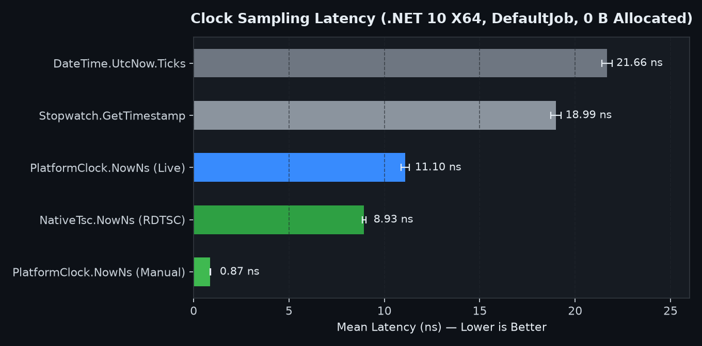
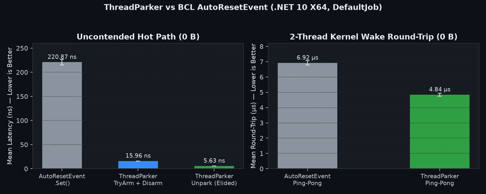

# Benchmark Results & Analysis

Measured with BenchmarkDotNet v0.15.8 on Linux (Arch Linux), 11th Gen Intel Core i3-1115G4 (1 CPU, 4 logical / 2 physical cores), `.NET 10.0.2 (X64 RyuJIT x86-64-v4)`, `DefaultJob`, `[MemoryDiagnoser]`.

Reproduce locally:

```bash
dotnet run --project benchmark/Platform.Benchmark -c Release -- --filter "*"
```

All 17 benchmarks run under `DefaultJob`. Sub-nanosecond and few-nanosecond primitives (`ClockBenchmark`, `ThreadParkerBenchmark` uncontended paths, `SharedMemoryBenchmark`) use `OperationsPerInvoke` batching (`64` or `256`) so per-invocation timing stays well above timer noise. Multi-threaded ping-pong tests use pre-spawned persistent background threads with `0 B` harness allocation.

---

## 1. Time & Clocks (`ClockBenchmark`)



| Method | Mean | Error | StdDev | Ratio | Allocated |
| :--- | ---: | ---: | ---: | ---: | ---: |
| `Stopwatch_GetTimestamp` *(baseline)* | 18.99 ns | ±0.26 ns | 0.20 ns | 1.00 | 0 B |
| `DateTime_UtcNow_Ticks` | 21.66 ns | ±0.27 ns | 0.23 ns | 1.14 | 0 B |
| `NativeTsc_NowNs` | 8.93 ns | ±0.09 ns | 0.07 ns | 0.47 | 0 B |
| `PlatformClock_NowNs_Live` | 11.10 ns | ±0.22 ns | 0.60 ns | 0.58 | 0 B |
| `PlatformClock_NowNs_Manual` | 0.87 ns | ±0.02 ns | 0.01 ns | 0.05 | 0 B |

### Why it behaves this way

1. `NativeTsc.NowNs()` (8.93 ns) is roughly 2.1x faster than `Stopwatch.GetTimestamp()` (18.99 ns) and 2.4x faster than `DateTime.UtcNow.Ticks` (21.66 ns) on x64 because it reads the CPU timestamp counter directly via a tiny `RDTSC` stub and scales the delta with a 128-bit `BigMul` shift against a Seqlock-protected anchor block. Because x86-64 TSO guarantees load-load ordering in hardware, the Seqlock reader does not emit an `MFENCE`.
2. `PlatformClock.NowNs(PlatformClockBlock*)` adds ~2 ns in live mode (11.10 ns) for the pointer-safety and `IsManual` branch. In manual testing mode it is a single volatile load (0.87 ns).
3. On ARM64 (Linux ARM64, Apple Silicon) or W^X-restricted runtimes where executable pages cannot be allocated, `NativeTsc` automatically falls back to a UTC-anchored `Stopwatch.GetTimestamp()` path, which reads `CNTVCT_EL0` / `mach_absolute_time` in user space.

---

## 2. Thread Parking & Wake (`ThreadParkerBenchmark`)



| Method | Mean | Error | StdDev | Ratio | Allocated |
| :--- | ---: | ---: | ---: | ---: | ---: |
| `Bcl_AutoResetEvent_Set_Uncontended` *(baseline)* | 220.87 ns | ±5.50 ns | 15.79 ns | 1.00 | 0 B |
| `ThreadParker_Unpark_ElidedWhileRunning` | 5.63 ns | ±0.11 ns | 0.22 ns | 0.03 | 0 B |
| `ThreadParker_TryArm_Disarm` | 15.96 ns | ±0.11 ns | 0.09 ns | 0.07 | 0 B |
| `Bcl_AutoResetEvent_PingPongRoundTrip` *(2-thread)* | 6,920.17 ns | ±137.73 ns | 158.61 ns | 31.50 | 0 B |
| `ThreadParker_PingPongRoundTrip` *(2-thread)* | 4,835.46 ns | ±95.66 ns | 234.65 ns | 22.01 | 0 B |

### Why it behaves this way

1. Under normal load, consumer daemons are already awake draining rings. Calling `AutoResetEvent.Set()` unconditionally enters the managed/native synchronization layer on every enqueue (~221 ns). `NativeThreadParkerHandle.Unpark()` performs a single atomic `Interlocked.Exchange` on the 64-byte-aligned sleep flag; if the consumer is not in `StateParked`, it skips the OS syscall entirely (5.63 ns — ~39x faster).
2. On the consumer side, `TryArm()` + `Disarm()` (15.96 ns) lets a worker double-check an empty ring before paying for a kernel sleep, preventing missed-signal races without locking.
3. When threads actually park and wake across cores (`PingPongRoundTrip`), `ThreadParker` completes a full two-way wakeup round-trip in 4.84 µs vs 6.92 µs for `AutoResetEvent` (~1.43x faster) because it talks directly to the underlying POSIX `sem_t` (Linux) or Win32 event handle (Windows) without managed wait-handle overhead.

---

## 3. Virtual Memory Maps (`NativeMemoryMapBenchmark`)

| Method | Mean | Error | StdDev | Ratio | Allocated |
| :--- | ---: | ---: | ---: | ---: | ---: |
| `ManagedArray_SequentialSum_64KB` *(baseline)* | 4.01 µs | ±0.12 µs | 0.32 µs | 1.00 | 0 B |
| `NativeMemoryMap_TypedSpan_SequentialSum_64KB` | 4.08 µs | ±0.11 µs | 0.31 µs | 1.02 | 0 B |
| `AnonymousMap_DemandPaged_CreateAndTouchAllPages_64KB` | 18.21 µs | ±0.66 µs | 1.87 µs | 4.57 | 72 B |
| `AnonymousMap_PreFault_CreateAndTouchAllPages_64KB` | 16.58 µs | ±0.33 µs | 0.94 µs | 4.16 | 72 B |

### Why it behaves this way

1. Streaming 64 KB through `NativeMemoryMap.AsSpan<long>()` runs at 4.08 µs — effectively identical to a managed `long[]` (4.01 µs) while living completely outside the GC heap.
2. When every page in a 64 KB mapping is touched, `MemoryMapOptions.PreFault` (`MAP_POPULATE` on Linux) is ~10% faster (16.58 µs vs 18.21 µs) because the kernel populates all page table entries in one pass during `mmap` instead of taking 16 separate minor page faults during user-space writes. (The 72 B allocation on the `CreateAndTouchAllPages` rows is the managed `NativeMemoryMap` RAII wrapper object itself; the steady-state read/write path allocates 0 B.)

---

## 4. Partitioned Shared Memory (`SharedMemoryBenchmark`)

| Method | Mean | Error | StdDev | Allocated |
| :--- | ---: | ---: | ---: | ---: |
| `Session_GetRegion` | 2.06 ns | ±0.06 ns | 0.18 ns | 0 B |
| `CachedRegion_ReadInt64` | 0.87 ns | ±0.03 ns | 0.09 ns | 0 B |
| `CachedRegion_AsRefInt64` | 0.98 ns | ±0.05 ns | 0.15 ns | 0 B |

### Why it behaves this way

`SharedMemorySession` resolves all Page 0 partition descriptors once during creation/attachment into a flat array of `SharedMemoryRegion` value types. Calling `GetRegion(tag)` is a short linear scan over cached structs (2.06 ns), and once cached on a worker, `Read<T>` / `AsRef<T>` compile down to a bounds check plus direct pointer dereference (< 1 ns, 0 B).
